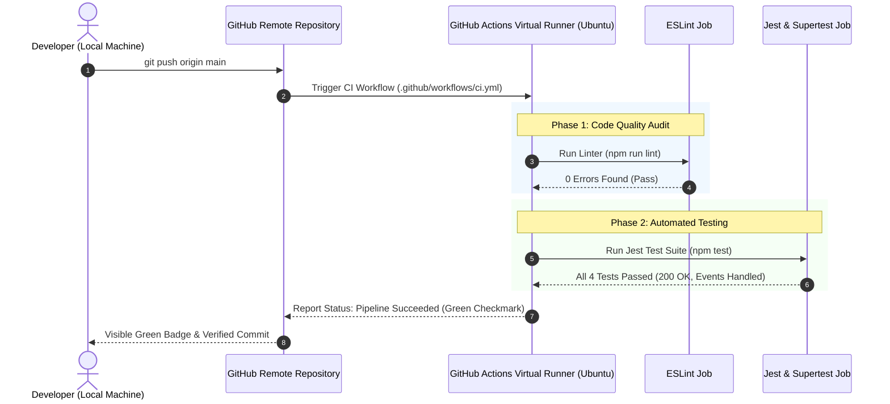

# Practical 12: CI/CD Pipeline with GitHub Actions

| Parameter | Details |
|---|---|
| **Course** | ITUE301 Advanced Web Development Frameworks (AWFW) |
| **Topic** | CI/CD Pipeline with GitHub Actions |
| **CO / PO Mapping** | **CO5** / **PO3, PO5** |
| **Runtime & Tools** | GitHub Actions, Node.js (v18), Jest, Supertest, ESLint |
| **Author** | 24DCS038 |

---

## 1. Objective

To automate the continuous integration and testing workflow of the full-stack Task Management application using a GitHub Actions CI/CD pipeline, catching bugs early on every commit, and demonstrating both failure and success pipeline states.

---

## 2. CI/CD Architecture & Pipeline Flow

### Pipeline Flowchart

```
                          git push origin main / Pull Request
                                           │
                                           ▼
                       GitHub Actions Trigger (on: push, pull_request)
                                           │
                     ┌─────────────────────┴─────────────────────┐
                     ▼                                           ▼
             Job 1: lint (ESLint)                     Job 2: build-and-test (Jest)
             ├── Checkout code                        ├── Checkout code
             ├── Setup Node.js 18                     ├── Setup Node.js 18
             ├── Install dependencies                 ├── Install dependencies
             └── Run ESLint rules                     └── Run Jest & Supertest suite
                     │                                           │
                     └─────────────────────┬─────────────────────┘
                                           ▼
                       Pass / Fail Pipeline Status Report
                        ├── Green Checkmark (All Passed)
                        └── Red X (Broken Test / Linter Error)
```

### Mermaid Sequence Diagram



---

## 3. Key Concepts & Analysis Questions

### Q1: What is the difference between Continuous Integration and Continuous Deployment, and which one does this practical actually demonstrate?
**Answer:**  
- **Continuous Integration (CI):** The practice of automating the integration of code changes from multiple contributors into a single repository. Code is validated by automatically building and running automated tests against every push to detect defects as early as possible.
- **Continuous Deployment (CD):** The automated process where changes that pass the automated tests are deployed automatically to production or staging environments without manual human intervention.
- **Which one this practical demonstrates:** This practical demonstrates **Continuous Integration (CI)**. It automates dependency installation, linting code quality, and running automated integration test suites on GitHub virtual runners, reporting pass/fail feedback before any deployment takes place.

### Q2: Why does running tests automatically on every push catch problems earlier than testing manually before a release?
**Answer:**  
1. **Immediate Feedback Loop:** Developers get notified within minutes of pushing code if a change broke existing functionality, making the bug trivial to pinpoint to the exact commit.
2. **Elimination of Human Error:** Manual testing often skips edge cases or forgets regression testing on untouched modules. Automated suites execute consistently across all defined tests.
3. **Prevents Accumulation of Debt:** In manual pre-release testing, weeks of combined changes are audited at once, turning bug isolation into a time-consuming diagnostic nightmare.

### Q3: What would happen to the pipeline if the test file path were incorrect — would the workflow fail at the same step as a genuine test failure?
**Answer:**  
- If the test file path or glob pattern is incorrect (e.g., pointing to a non-existent path), Jest will exit with a configuration error: `No tests found matching the path` (or exit code 1 if configured with `--passWithNoTests=false`).
- While it still fails within the `build-and-test` job, the **failure reason in the logs is distinctly different**:
  - A **genuine test failure** logs assertion errors (e.g., `Expected: 200, Received: 500` along with a stack trace of the endpoint).
  - An **incorrect path failure** fails during test discovery before any test suites or assertions even begin executing.

---

## 4. Supplementary Solutions Implemented

1. **Pre-Test Linter Job (`lint`):**
   - Configured `.eslintrc.json` and a dedicated `lint` job running `npm run lint` on Ubuntu runner prior to running tests.
2. **Branch & Pull Request Protection Triggers:**
   - Workflow trigger configured for both `push` and `pull_request` targeting `main`, preventing untested PRs from merging.
3. **Pipeline Status Badge:**
   - Added dynamic GitHub Actions status badge showing real-time build status directly in the documentation:
     ``

---

## 5. Automated Test Suite (`tests/api.test.js`)

The test suite validates:
1. `GET /` - Public health check and active CI/CD metadata.
2. `GET /tasks` - Core tasks endpoint returns status 200.
3. `GET /cache/stats` - Verifies in-memory cache status endpoint.
4. `POST /tasks/test-error` - Confirms that background event errors are safely caught by listeners without terminating the server process.

---

## 6. Demonstrating Failed vs Passed Pipeline

### Step A: Triggering Pipeline Failure (Red X)
1. Run or rename the deliberately broken test scenario from `tests/broken.test.js.example`:
   ```javascript
   test('DELIBERATELY BROKEN', async () => {
     const res = await request(app).get('/');
     expect(res.statusCode).toBe(999); // Intentionally fails
   });
   ```
2. Run `npm run test:broken` or push to GitHub.
3. GitHub Actions triggers, the assertion fails, and the job reports a **Red X**.

### Step B: Fixing the Test & Passing the Pipeline (Green Checkmark)
1. Revert or correct the assertion back to `expect(res.statusCode).toBe(200);`.
2. Run `npm test` or push to GitHub.
3. All tests pass with 100% success and GitHub Actions displays the **Green Checkmark**.
